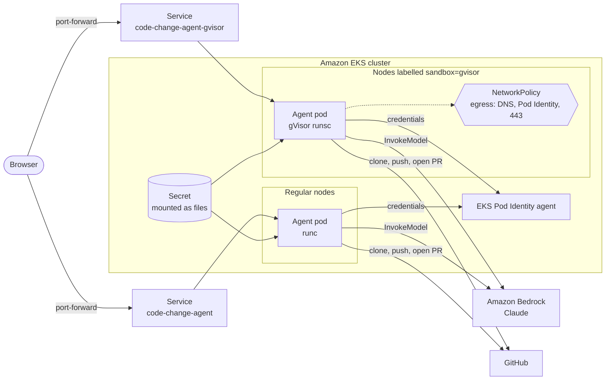

# COM329 — Sandboxing AI coding agents on Amazon EKS with gVisor

**AWS re:Invent 2026** · Community session · COM329

An AI coding agent is untrusted code by design: it clones repositories it has never seen, runs `git` and other tools against them, and acts on instructions written in natural language. This repository shows one way to run such an agent on Amazon EKS so that a misbehaving or compromised agent can't reach the node's kernel or the rest of the cluster.

The sample is a small, working **code-change agent** built with [Strands Agents](https://strandsagents.com/) and Claude on [Amazon Bedrock](https://aws.amazon.com/bedrock/). You give it a GitHub repository and a change in plain English; it clones the repo, reads and edits files, pushes a branch and opens a pull request. The same container image is deployed twice, side by side, so you can compare:

| | `code-change-agent` (direct) | `code-change-agent-gvisor` (sandboxed) |
| --- | --- | --- |
| Container runtime | `runc` (shares the node kernel) | [gVisor](https://gvisor.dev/) `runsc` (user-space kernel) |
| Kubernetes API token in pod | yes (default) | no (`automountServiceAccountToken: false`) |
| Network | unrestricted | DNS, Pod Identity agent and outbound HTTPS only (`NetworkPolicy`) |
| AWS credentials | EKS Pod Identity, Bedrock invoke only | same |
| Nodes | any node *not* labelled `sandbox=gvisor` | only nodes labelled `sandbox=gvisor` |

## What you'll learn

- How to install gVisor on EKS managed nodes and expose it through a `RuntimeClass`.
- How to give an agent pod least-privilege AWS access with EKS Pod Identity and no static keys.
- How to cut an agent off from the cluster (API server, kubelets, other pods, IMDS) with a `NetworkPolicy` while still letting it reach Bedrock and GitHub.
- How to keep secrets out of the image and out of environment variables by mounting them as files.

## Architecture



Inside each pod the flow is the same:

1. The web page (`static/index.html`) posts a repository and a task to `POST /runs`.
2. `server.py` starts the agent in a background thread and streams its steps back over server-sent events.
3. `agent.py` runs a Strands agent with six tools — `clone_repo`, `read_file`, `grep_files`, `write_file`, `push_branch`, `create_pull_request` — all scoped to one temporary clone that is deleted when the run ends.

## Repository layout

```
.
├── README.md                   # this file: session overview
├── code-change-agent/          # the sample agent, container image and deployment
│   ├── README.md               # full setup, deployment and cleanup guide
│   ├── agent.py                # Strands agent and its tools
│   ├── server.py               # FastAPI app + server-sent events
│   ├── config.py               # settings: env vars, .env, mounted Secret files
│   ├── static/index.html       # single-page UI
│   ├── Dockerfile
│   ├── docker-compose.yml
│   ├── .env.example
│   ├── k8s/
│   │   ├── serviceaccount.yaml
│   │   ├── deployment.yaml          # direct (runc)
│   │   ├── deployment-gvisor.yaml   # sandboxed (gVisor)
│   │   └── gvisor/
│   │       ├── gvisor-installer.yaml    # DaemonSet that installs runsc on labelled nodes
│   │       ├── runtimeclass-gvisor.yaml
│   │       └── networkpolicy-gvisor.yaml
│   └── scripts/
│       ├── setup-aws.sh        # ECR image, IAM role, Pod Identity association
│       └── deploy.sh           # Secret, gVisor setup, both deployments, status, delete
├── CONTRIBUTING.md
├── CODE_OF_CONDUCT.md
├── SECURITY.md
└── LICENSE
```

## Quick start

> **Prerequisites:** an AWS account with access to a Claude model in Amazon Bedrock, an EKS cluster you can administer (with the EKS Pod Identity Agent add-on), `aws`, `kubectl` and `docker` on your machine, and a GitHub token that can push to and open pull requests on a test repository. Details in [code-change-agent/README.md](code-change-agent/README.md#prerequisites).

**Locally**, in about two minutes:

```bash
cd code-change-agent
python3 -m venv .venv && source .venv/bin/activate
pip install -r requirements.txt
cp .env.example .env            # set GITHUB_TOKEN; AWS credentials come from your usual profile
uvicorn server:app --reload     # open http://localhost:8000
```

**On Amazon EKS**, direct and gVisor side by side:

```bash
cd code-change-agent
cp .env.example .env                                   # set GITHUB_TOKEN
CLUSTER=<your-cluster> REGION=us-east-1 scripts/setup-aws.sh   # prints the IMAGE to use
scripts/deploy.sh setup-gvisor <node-name>             # one-time, or --all
IMAGE=<printed-image> scripts/deploy.sh all
kubectl port-forward svc/code-change-agent-gvisor 8001:80      # open http://localhost:8001
```

Before deploying to a cluster other than the one this was built on, update the CIDRs in [`k8s/gvisor/networkpolicy-gvisor.yaml`](code-change-agent/k8s/gvisor/networkpolicy-gvisor.yaml). See [Adapting to your cluster](code-change-agent/README.md#adapting-to-your-cluster).

Full instructions, configuration reference, troubleshooting and cleanup: **[code-change-agent/README.md](code-change-agent/README.md)**.

## Try it

Point the agent at a throwaway repository you own and ask for something small, for example:

- *"Add a `/version` endpoint that returns the app version from `package.json`."*
- *"Fix the typo in the README heading."*
- *"Add a unit test for the `slugify` helper."*

Run the same task against both deployments. The result is identical; the difference is what the pod *could* have done if the agent had been tricked into running something hostile. Some things to try from inside each pod:

```bash
# Which kernel am I talking to? gVisor prints its own boot messages.
kubectl exec deploy/code-change-agent-gvisor -- dmesg | head
kubectl exec deploy/code-change-agent        -- dmesg | head    # usually denied: it's the host kernel

# Can I reach the Kubernetes API server?
kubectl exec deploy/code-change-agent        -- python -c "import urllib.request,ssl;print(urllib.request.urlopen('https://kubernetes.default',context=ssl._create_unverified_context(),timeout=3).status)"
kubectl exec deploy/code-change-agent-gvisor -- python -c "import urllib.request,ssl;print(urllib.request.urlopen('https://kubernetes.default',context=ssl._create_unverified_context(),timeout=3).status)"
```

From the direct pod the API server answers (you get an `HTTP Error 401/403`, which proves it is reachable). From the gVisor pod the call times out because the `NetworkPolicy` blocks it.

## Important

This is sample code for learning and demonstration. It is **not** production ready:

- The web UI has **no authentication**. Anyone who can reach the Service can make the agent push branches and open pull requests with your `GITHUB_TOKEN`. Keep the Services `ClusterIP` and use `kubectl port-forward`; don't put them behind a public load balancer.
- Use a GitHub token scoped to a test repository (a fine-grained token with *Contents* and *Pull requests* write on that repo only).
- Runs are held in memory, so the deployments run a single replica and a restart loses in-flight runs.
- The gVisor installer is a privileged DaemonSet that edits `/etc/containerd/config.toml` and restarts containerd on the nodes you label. Use dedicated nodes or a dedicated node group.

See [SECURITY.md](SECURITY.md) for how to report a security issue.

## Resources

### Sandboxing and gVisor
- [gVisor documentation](https://gvisor.dev/docs/)
- [gVisor: containerd quick start](https://gvisor.dev/docs/user_guide/containerd/quick_start/)
- [Kubernetes RuntimeClass](https://kubernetes.io/docs/concepts/containers/runtime-class/)
- [Kubernetes Network Policies](https://kubernetes.io/docs/concepts/services-networking/network-policies/)

### Amazon EKS
- [Amazon EKS User Guide](https://docs.aws.amazon.com/eks/latest/userguide/what-is-eks.html)
- [Amazon EKS Best Practices Guide — Security](https://docs.aws.amazon.com/eks/latest/best-practices/security.html)
- [EKS Pod Identity](https://docs.aws.amazon.com/eks/latest/userguide/pod-identities.html)
- [Network policies with the Amazon VPC CNI](https://docs.aws.amazon.com/eks/latest/userguide/cni-network-policy.html)
- [EKS Workshop](https://www.eksworkshop.com/)

### Agents on AWS
- [Strands Agents](https://strandsagents.com/)
- [Amazon Bedrock User Guide](https://docs.aws.amazon.com/bedrock/latest/userguide/what-is-bedrock.html)
- [Amazon Bedrock AgentCore samples](https://github.com/awslabs/amazon-bedrock-agentcore-samples)

### Related re:Invent sessions
- [CON325 — Running AI agents you can trust on Amazon EKS (2026)](https://github.com/aws-containers/reinvent/tree/main/sessions/2026/CON325)
- [CNS422 — Modernize containers for AI agents using AgentCore Gateway (2025)](https://github.com/aws-containers/reinvent/tree/main/sessions/2025/CNS422)

## Session materials

- Slides: _added after the event_
- Recording: _added after the event_

## Maintainers

- Adit Modi
- Ishan Modi

## Contributing

Issues and pull requests are welcome. See [CONTRIBUTING.md](CONTRIBUTING.md).

## License

MIT. See [LICENSE](LICENSE).
